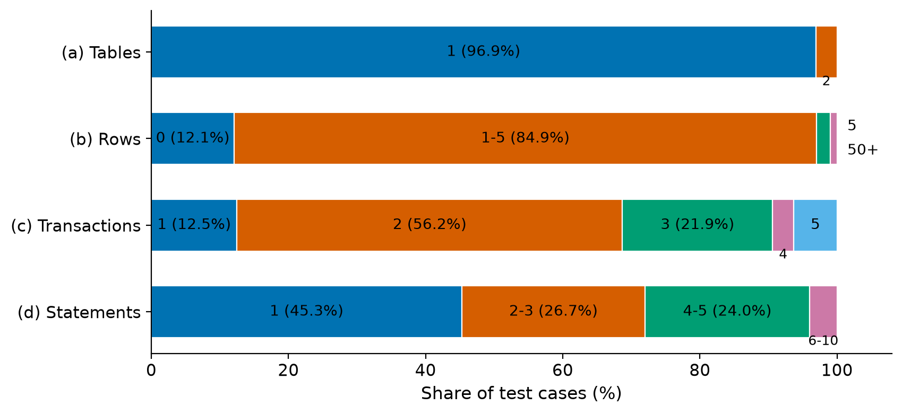
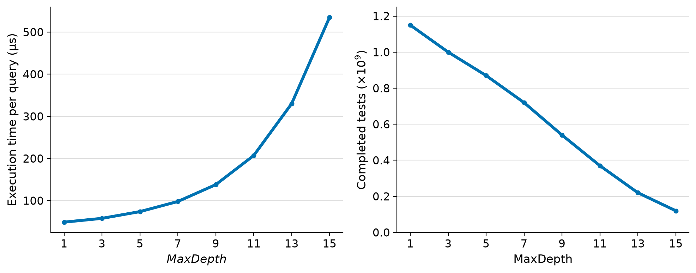
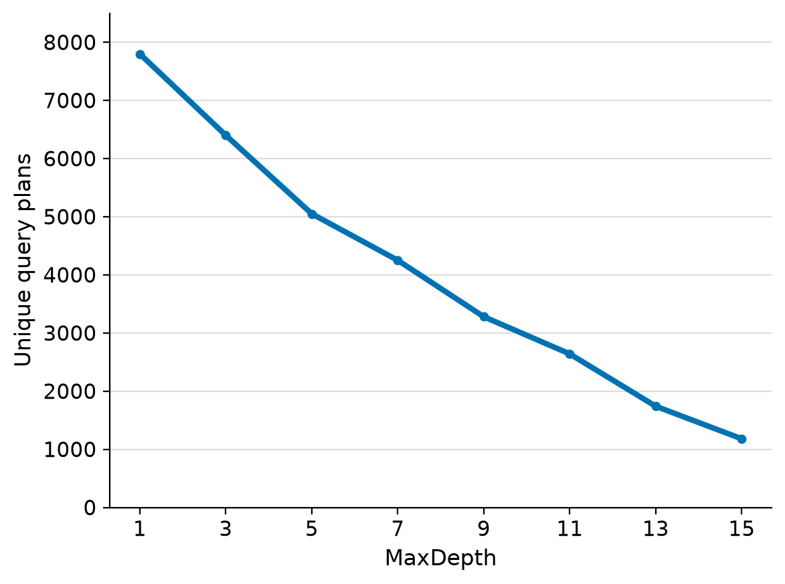
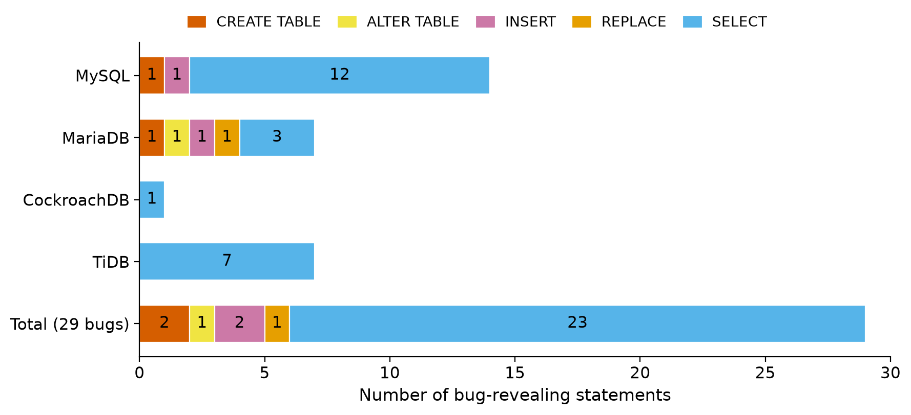
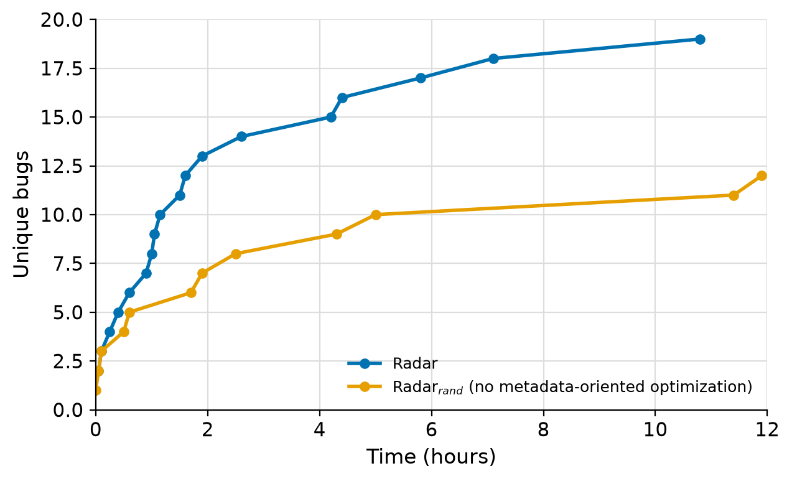

**Project 1 Report**

# Detecting Logic Bugs in Relational Database Systems

CSI 5137 A00  
Advanced Topics in Databases and Data Management

Group 12  
Berti Cruz Nogueira, Fernando  
Paul, Saatvik  
Ahn, Haekwon

## Abstract

Logic bugs can cause a relational database to return incorrect results or retain an incorrect state without crashing. This report reviews four selected papers from 2024–2025: CODDTest, DDLCheck, WriteCheck, and Radar. We compare their test oracles, equivalence assumptions, supported features, and published experiments. The methods expose different failure mechanisms by transforming expressions, schema histories, metadata, or transaction schedules. Their evaluations demonstrate practical bug detection, but differences in workloads, versions, budgets, and confirmation procedures prevent a direct ranking by total bugs. The review argues that oracle validity and complementary coverage provide a stronger basis for comparison than throughput or headline discovery counts alone.

# 1 Introduction

A database crash is visible. An incorrect query result can look ordinary: a missing product, an unexpected total, or an update that appears to succeed. Applications may then use the result in later decisions. Relational database correctness depends on interactions between query optimization, schema maintenance, metadata, and transaction processing, making these silent failures a significant data-management problem.

The research question is how different equivalence assumptions determine the logic bugs an oracle can detect, and how convincingly the experiments demonstrate that capability. CODDTest varies expression evaluation [1]; DDLCheck varies the history used to construct a schema [2]; WriteCheck compares restricted concurrent writes with serial references [3]; and Radar removes optional metadata while retaining query-relevant data [4]. The report follows these four papers selected in the project declaration. No new experimental results are claimed: measurements are taken from their studies, while the common formal model and running example are explanatory analysis.

Sections 2 and 3 define and motivate the problem. Section 4 groups and compares the related work. Section 5 reviews experimental setups, datasets, metrics, procedures, and results. Sections 6 and 7 assess the evidence and draw conclusions. Two older papers, NoREC and TLP, provide background for the baselines used in the selected studies [5, 6].

# 2 Problem definition and discussion

## 2.1 High level description

Consider a database that stores product quantities. Two SQL executions that are equivalent for the same stored data should produce equivalent observations. Replacing a deterministic expression with its evaluated value should not change the selected products. Rebuilding a table directly should not change its subsequent behaviour if the rebuilt table has the same relevant schema and contents. Similarly, removing an index should not change the answer to a deterministic query that does not explicitly depend on that index. Logic testing searches for cases where these expectations fail.

## 2.2 Formal definition and search objective

Let E be a DBMS implementation and let D = (S, V, M, H) describe a database state. S is the visible schema, V the stored values, M the optional metadata and configuration relevant to execution, and H the construction history and internal state. These components are an analytical separation; an actual DBMS may represent them together. Let W be a query, a statement sequence, or a transaction workload, and let C include the SQL dialect, session settings, and isolation mode.

An observation O(E, D, W, C) contains the information that the oracle checks: query rows, success or failure of statements, final table contents, or the resulting schema. Given a transformation T, write T(D, W) = (D′, W′). A valid test requires a precondition P that states when the transformed execution should be equivalent. The desired property is:

P(D, W, C)  ⇒  O(E, D, W, C) ≡ O(E, D′, W′, C).

The search objective is to find D, W, and T for which P holds but the observed equivalence fails. Such a result is a candidate defect. Its interpretation still depends on validating P, excluding permitted nondeterminism, reducing the test, and checking the DBMS semantics. The model describes the common testing task rather than claiming that all four papers use the same formalism.

## 2.3 Detailed interpretation of the formal definition

For an unordered SQL result, equivalence normally compares multisets of rows: order is ignored, but duplicate counts are preserved. A set comparison could hide a duplicate-related bug. If the query requests a deterministic order, that order becomes relevant. NULL values, data types, collation, rounding, and errors also require consistent treatment. A query using a volatile function or an under-specified LIMIT is unsuitable unless the oracle accounts for its behaviour.

For state-changing statements, equal query output alone is insufficient. Two INSERT statements may both report success while storing different values. The observation must therefore include the relevant final state. For transactions, the initial state must be restored before each replay, and committed, aborted, and failed statements must be distinguished. These requirements are the practical meaning of the precondition P: they prevent normal semantic differences from being mistaken for defects.

In words, P specifies when the original and transformed workloads ask the same semantic question. The implication then requires their observations to agree. A counterexample is useful only when P is satisfied; otherwise the two executions may legitimately differ. What is sought is a concrete, reproducible witness to a violated relation, not a proof that all other executions are correct.

## 2.4 Pseudoalgorithm

Input: DBMS E, configuration C, generator G, oracle family F

Output: reduced candidate inconsistencies

while testing budget remains:

    D, W = G.next_case(C)

    T, P = F.choose_transformation(D, W, C)

    if not validate_preconditions(P, D, W, C): continue

    D2, W2 = T(D, W)

    A = execute_from_clean_state(E, D, W, C)

    B = execute_from_clean_state(E, D2, W2, C)

    if not equivalent(A, B, F.observation_rules):

        case = reduce_while_preserving_mismatch(D, W, T, C)

        record(case, versions, outcomes, seed, configuration)

        classify_semantics_and_deduplicate(case)

The procedure is a synthesis for this review. CODDTest requires auxiliary expression evaluation, and WriteCheck may execute both transaction-level and statement-level references. Their implementations therefore use more steps than the two observation calls shown here. The essential order is to validate the comparison, obtain observations from controlled states, and preserve the mismatch during reduction.

# 3 Motivation

## 3.1 Motivating example

Suppose an inventory service stores Product(id, quantity, reserved). Its available stock is quantity minus reserved. An expression oracle can compare a query using this calculation with one using values evaluated on the same snapshot. A schema-history oracle can compare a table reached through column changes with a table created directly in its final form. A metadata oracle can compare a fixed read workload with and without an optional index. A transaction oracle can examine overlapping in-database updates and compare the final quantities with an admissible serial replay.

This example is illustrative, not a bug found in the reviewed studies. It shows why a correct result from one test says little about the other mechanisms. An expression test on a newly created table may never exercise the state left by a migration. A metadata test using one connection may never exercise write conflicts. Transaction testing also needs care: an application that reads a quantity and later writes a value calculated from that read can violate WriteCheck’s workload restriction. An ordinary application race must not be presented as proof of a DBMS implementation defect.

## 3.2 Benefits and specific challenges

Database developers benefit from small tests that expose incorrect assumptions in optimization and execution code. Application teams benefit because an error in stored state can survive beyond the request that caused it. Researchers benefit from oracles that apply to DBMS-specific features without requiring another implementation of the same dialect. These benefits depend on producing reports that developers can reproduce and interpret.

The difficulty is specific: valid SQL is not necessarily a valid metamorphic test; the reference execution can share the original fault; schema changes create hidden history; and concurrent completion does not always imply a universally valid serialization order. The reviewed methods make progress by narrowing the comparison. Their limitations show why expanding the generator without revisiting the oracle’s assumptions can increase false alarms rather than useful coverage.

# 4 Related work

We group the papers by their reference construction. Group A tests read-query consistency by changing expressions or optional metadata, covering CODDTest and Radar. Group B changes schema construction history, covering DDLCheck. Group C changes transaction execution order, covering WriteCheck. Each group is examined for its essential contribution, equivalence condition, and limitations.

## 4.1 Group A Query consistency through expression transformation

### 4.1.1 Contribution and procedure

CODDTest uses constant folding and propagation as a basis for logic-bug detection [1, Section 3]. It generates an expression, evaluates it through an auxiliary query, and substitutes the resulting value into a larger query. The original and folded queries should agree for the database state used to construct the replacement. This makes expression evaluation available as a source of reference values without requiring the testing tool to reimplement each SQL operator.

The distinction between independent and dependent expressions is essential. An independent expression does not depend on columns from the outer query context and can be replaced with a suitable constant or result representation. A dependent expression can evaluate differently for different rows. CODDTest therefore builds a mapping from relevant outer-column values to the evaluated expression result, represented using CASE. Replacing every row-dependent expression with one scalar would invalidate the test.

Using the notation from Section 2, let e be a selected expression and A(e) its auxiliary query. Its evaluated representation is R = E(D, A(e)). The folded query is Q′ = Q[e ← R], with a row-dependent representation where needed. The tested relation is E(D, Q) ≡ E(D, Q′). Here Q′ is constructed for D; it is not automatically equivalent on a later database snapshot.

### 4.1.2 Illustrative application

For the inventory example, imagine the stored rows have (id, quantity, reserved) values (1, 8, 3) and (2, 4, 4). An auxiliary evaluation gives availability values 5 and 0. On this unchanged state, a predicate based on quantity − reserved can be compared with a CASE expression mapping the corresponding row context to 5 or 0. The example uses unique identifiers for clarity. A real implementation must preserve the appropriate context, types, and NULL behaviour rather than assuming every table has a convenient key.

### 4.1.3 Strengths and limitations

The method reaches expressions and subqueries that some earlier predicate-based oracles cannot handle. Its useful contrast is between evaluating a calculation in an auxiliary context and evaluating it inside a larger query, where optimizations may differ. The paper implements the approach in SQLancer and studies SQLite, MySQL, CockroachDB, DuckDB, and TiDB [1]. Subquery support is particularly relevant because changing query structure can expose execution paths that merely increasing expression depth does not reach.

The reference is nevertheless computed by the same DBMS. If the auxiliary and original executions make the same mistake, the comparison can pass. Literal construction, casts, NULL-sensitive matching, and preservation of subquery result types also matter. An expression involving a volatile function may have no stable replacement value. These are restrictions on the relation itself, not minor implementation details.

CODDTest’s evaluation gives evidence of practical effectiveness, including logic bugs outside the reach of the compared oracles. It does not establish completeness over SQL expressions or show that every extra query plan corresponds to a distinct correctness risk. For deployment, its strongest role is targeted expression and subquery testing on fixed states. Schema evolution and transaction scheduling require additional oracles.

## 4.2 Group A Query consistency through metadata transformation

### 4.2.1 Contribution and procedure

Radar constructs a raw database by removing optional metadata while preserving the data needed by a query [4]. It compares query behaviour on the original and raw databases. An index or constraint may allow an optimizer to use a different plan, but a deterministic read query over the same relevant values should retain its meaning when the transformation is valid. The approach tests whether metadata-dependent execution agrees with a simpler reference.

This is a different equivalence from DDLCheck’s. DDLCheck aims to preserve the final relevant schema while changing how it was obtained. Radar intentionally changes selected schema properties, such as indexes and constraints. It therefore needs a more restricted workload: a query must remain meaningful on both versions and must not directly require the removed metadata.

If raw(D) denotes a valid raw construction, the central relation is E(D, Q) ≡ E(raw(D), Q). The stored values and relevant type semantics must remain compatible. Materializing the values of a generated column, for example, requires preserving its evaluated data when the generating constraint is removed. Copying table names and visible values alone is not a general proof of equivalence for every SQL operation.

### 4.2.2 Scope of the equivalence

For the inventory example, an index on quantity may change how a read query locates available products. If the rows and relevant SQL semantics are preserved, the answer should agree without the index. A query explicitly naming that index is different: it may fail on the raw database for a valid reason. Likewise, a query asking for a column’s default value depends on metadata that the transformation may remove. Radar excludes such cases, as well as database-specific identity functions and nondeterministic functions [4, Section 3.2.2].

The relation should not be extended casually to updates. Removing a UNIQUE constraint can legitimately change whether an INSERT succeeds. The read-only comparison over a fixed copied state is what makes the tested equivalence plausible. This boundary is useful because it identifies a concrete area where DDLCheck’s same-schema comparison can provide coverage that Radar’s metadata removal does not.

### 4.2.3 Strengths and limitations

Radar’s metadata-oriented optimization prioritizes structurally different metadata configurations. It addresses a weakness of purely syntactic randomness: renaming a table or generating another similar query may do little to change the optimizer assumptions being tested. The implementation uses SQLancer-based generation and evaluates five DBMSs [4]. The experiments include an ablation of this optimization, making it possible to assess more than the total bug yield.

A reported case, TiDB#44219, evaluates a comparison involving an unsigned integer column and a negative string-derived value differently with and without a NOT NULL constraint [4, Listing 3]. The stored value is unchanged; metadata affects the conversion path. The raw database remains an execution in the same implementation. A bug present in both paths will not be exposed by agreement testing. Errors and undefined or implementation-dependent evaluation behaviour also complicate interpretation. The paper reports three false positives, which is evidence that a mismatch is not automatically a confirmed defect. Careful reduction and developer feedback are part of the validation process.

Radar is most useful when optional metadata changes execution strategy while leaving the chosen read query’s answer invariant. Its broad query support is valuable within that condition. It should not be read as a claim that all metadata can be removed without changing database semantics.

## 4.3 Group B Schema history equivalence

### 4.3.1 Contribution and procedure

DDLCheck tests whether the history used to build a schema changes later behaviour when the final schemas should be equivalent [2]. It first generates a sequence containing schema operations such as CREATE, ALTER, and DROP. It then synthesizes a simpler sequence that creates the intended final schema directly. The same subsequent statements are executed against the two databases. Differences in results, stored data, or schema behaviour indicate a candidate schema-related defect.

The important contrast is between user-visible equivalence and internal history. A database may retain dropped columns, cached descriptions, storage layouts, or other information that is not visible in the final CREATE definition. These internal differences are often legitimate implementation choices. They become a correctness problem when they change the semantics of operations that should be equivalent.

Let H be the generated DDL history and S(H) its final relevant schema. Let synth(S(H)) be a direct construction sequence. DDLCheck seeks pairs for which the intended visible schemas agree, then compares the observations of the same workload W on the resulting databases. Both sides must begin the comparison with corresponding data. The approach does not require their files, identifiers, or physical layouts to be identical.

### 4.3.2 Representative failure

The paper’s motivating MariaDB case, MDEV#35122, creates a table with an integer column and a BLOB column under ROW_FORMAT=REDUNDANT, then drops the BLOB column [2, Listing 1]. Inserting into the remaining column fails with a row-size error. A table created directly with only the integer column accepts the insertion. The paper explains that the dropped column persists internally as a hidden column and affects the insertion path.

The example makes the contribution concrete. A test suite that only creates fresh tables with the final definition can miss the failure. A query-only oracle can also miss it because the revealing operation is an INSERT. The mismatch follows from the database’s construction history, even though the visible schema appears to offer the same operation.

### 4.3.3 Diversity strategy and limits

DDLCheck also avoids repeatedly testing histories that are structurally similar. Its optimization abstracts table structures and changes so that superficial differences, such as object names, do not consume the same testing effort. The experiments compare this strategy with a random variant and a stricter variant [2, Section 4.4]. The distinction matters: generating more histories is useful only if they expose meaningfully different schema-related states.

Equivalence still needs a sufficiently complete schema description. Defaults, generated columns, constraints, table options, and dependent objects can affect behaviour. A reconstruction that silently drops a relevant property creates a faulty reference. Conversely, a shared defect in both construction paths can remain invisible. The method’s abstraction may also group histories that differ in an unmodelled property. The reported ablation supports the chosen abstraction on the evaluated workload; it does not prove that filtering preserves every possible bug-triggering sequence.

DDLCheck is therefore most compelling for migration and schema-maintenance paths. Its overlap with Radar is expected because schema history can affect metadata used by query execution. That overlap does not eliminate the value of comparing the histories directly.

## 4.4 Group C Transaction execution equivalence

### 4.4.1 Why a separate oracle is needed

Concurrent transactions introduce a temporal problem. Even when every statement behaves correctly in isolation, overlapping writes can leave an incorrect final database state. WriteCheck studies write-specific serializability, abbreviated WSS, and uses serial reference executions to detect such failures [3]. Its focus is on transaction defects that affect stored state, which the paper classifies as critical transaction bugs.

The workload restriction is central: a write must not depend on values returned by an earlier read statement in the same transaction. A write can use explicit values or values read within that write, such as UPDATE t SET c = c + 1. This restriction separates the tested mechanism from many application-level read-modify-write races. It also limits how directly the method can be applied to an arbitrary production transaction trace.

### 4.4.2 Two reference executions

Transaction-level WSS compares a concurrent schedule with a corresponding serial schedule of the same transactions. Statement-level WSS further simplifies the serial schedule: aborted transactions are omitted, transaction-control statements from committed transactions are removed, and the remaining statements execute individually under autocommit. The two checks cover different behaviours. Transaction controls such as savepoints can require keeping the transaction-level reference intact [3, Section 2.2].

WriteCheck infers an order using First Commit/Rollback First Scheduled, or FCRFS. Transactions that complete earlier are placed earlier in the reference order, including the appropriate handling of autocommit statements. The method records actual execution behaviour, including blocking, errors, and aborts; it cannot safely infer the reference solely from the order in which a client submitted statements.

For an initial state D0, concurrent history Hc, and inferred reference Hf, the principal check is State(D0, Hc) = State(D0, Hf). Statement-level replay supplies a second reference where applicable. The paper also compares whether write operations succeed. These observations can reveal inconsistent effects even when read-result comparison is not the main objective.

### 4.4.3 Assumptions and limitations

FCRFS is not a universal definition of SQL serializability. The paper’s correctness argument assumes suitable identification and handling of write conflicts. Its evaluation discusses DBMS behaviours, including semi-consistent reads and the absence of gap locks, that can violate this expectation without being accepted as implementation bugs [3, Sections 4 and 6.4]. The reported false positives must therefore be treated as evidence about the oracle’s boundary.

The retrospective study finds WSS violations in 32 of 35 collected critical transaction bugs. Transaction-level WSS covers 15, while statement-level WSS covers 32 [3, Table 1]. This supports using both reference forms and shows that a simple serial replay can expose many known failures. It does not establish a 91.4% detection probability for unseen transaction defects: the corpus is selected from previously reported bugs, and the needed inputs are already known.

One reported TiDB case, TiDB#42486, leaves a newly inserted value in the concurrent final state, whereas the inferred serial execution leaves the table empty [3, Listing 4]. The authors trace the failure to a transaction that commits despite a conflict. WriteCheck extends the comparison beyond query optimization into transaction effects. Its practical appeal is the relatively simple reference construction. Its main cost is semantic qualification: the isolation mode, write-conflict rules, and workload restrictions determine whether a mismatch indicates a defect or an overly strong expectation.

## 4.5 Qualitative comparison and earlier reference methods

Table 1 groups the methods by the part of execution that changes and by the observation used to detect a disagreement. The grouping reflects the oracle relation, rather than the implementation language or the DBMSs used in evaluation.

| Method | Changed element | Main observation | Key validity condition |
| :---- | :---- | :---- | :---- |
| CODDTest [1] | Expression or subquery representation | Original and folded query results | Stable state and a faithful evaluated replacement |
| DDLCheck [2] | Schema construction history | Results, state, and schema behaviour | Equivalent relevant schema and corresponding data |
| Radar [4] | Optional metadata | Read-query behaviour | Data preserved; query independent of removed metadata |
| WriteCheck [3] | Concurrent versus inferred serial schedule | Final state and write outcomes | Restricted writes and applicable conflict semantics |

Table 1. Qualitative synthesis of the four test oracles. Conditions are summarized, not complete implementation specifications.

### 4.5.1 Sources of overlap

A query can be wrong because an expression rewrite interacts with a constraint or an index. Such a case might be exposed by CODDTest or Radar, provided their generators produce the necessary state and SQL. A migration can leave incorrect metadata that later affects a SELECT, allowing DDLCheck and Radar to overlap. The DDLCheck paper explicitly tests this overlap against its confirmed schema-related cases [2, Table 4].

Overlap should be assessed using the same bug case and compatible semantics. A method that can expose a case supplied by a researcher may still fail to generate it in an end-to-end run. Conversely, a generator may execute a revealing statement but lack an oracle that can recognise its wrong result. These are distinct limitations, so both should be reported.

### 4.5.2 Separation and earlier methods

CODDTest leaves construction history and concurrent scheduling outside its central transformation. Radar cannot use arbitrary state-changing workloads after removing constraints. DDLCheck focuses on equivalence between schema histories rather than transaction interleavings. WriteCheck observes write effects under a restricted transaction model and does not offer complete coverage of read anomalies. None of these limitations makes a method unsuccessful; each follows from the chosen relation.

All four methods also have a shared-error problem. Agreement between two executions is useful evidence of consistency, but both executions may be wrong in the same way. A diverse collection of oracles can reduce dependence on one reference path. It still cannot turn random testing into a proof of correctness.

NoREC [5] rewrites predicate evaluation into a reference form intended to avoid the optimizations being checked, then compares the qualifying-row counts. TLP [6] partitions a query using a predicate that is true, false, or NULL and recombines the partitions. Both provide important query-level baselines, but neither transformation alone varies schema history or transaction scheduling. DQE, discussed in the selected papers, compares predicate behaviour across SELECT, UPDATE, and DELETE; DQP compares equivalent query plans. These different reference constructions explain why the selected studies compare several baselines rather than one universal oracle.

# 5 Experimental studies

This section reviews the experiments reported by the authors. The studies use generated databases and SQL workloads rather than fixed application datasets. That choice fits the task: the aim is to explore semantic combinations and produce small counterexamples, not to measure application throughput on a large benchmark. However, generated workloads alone provide limited evidence about the frequency of these defects in production applications.

| Study | Environment and versions | Budget and controls |
| :---- | :---- | :---- |
| CODDTest [1] | Performance study: 64-core AMD EPYC 7763 at 2.45 GHz, 512 GB RAM, Ubuntu 22.04; SQLite 3.42.0.0 | 10 threads, 24 hours per configuration; default MaxDepth 3. Discovery campaign ran intermittently for four months. |
| DDLCheck [2] | 8 CPU cores, 32 GB RAM; MySQL 8.0.36, PostgreSQL 16.2, SQLite 3.43.0, MariaDB 11.3.2, CockroachDB 23.2, TiDB 8.0.0 initially | 24-hour testing rounds; 5,000 subsequent statements per database pair. Newer versions also tested during discovery. |
| Radar [4] | 8 CPU cores, 32 GB RAM; MySQL 8.0.32, SQLite 3.41.0, MariaDB 11.0.3, CockroachDB 22.2.5, TiDB 6.6.0 initially | Ten 24-hour discovery rounds per DBMS; 12-hour ablation and comparison runs. Versions updated during discovery. |
| WriteCheck [3] | 8 CPU cores, 32 GB RAM, Ubuntu 20.04; MySQL 8.0.32, PostgreSQL 15.2, SQLite 3.36.0, MariaDB 10.11.2, CockroachDB 22.2.5, TiDB 6.6.0 | Five rounds of about 24 hours; separate 12-hour baseline comparison. Isolation and concurrency modes recorded. |

Table 2. Published experimental conditions. Version lists describe study conditions, not current releases.

## 5.1 Experimental setup and comparability

Radar reports bounds of three tables, three columns per table, thirty INSERT statements, five index-creation statements, and three foreign-key additions [4, Section 3.2.1]. WriteCheck’s retrospective study shows that small databases can expose severe transaction failures, although its known bug cases should not be confused with a random sample of real workloads. CODDTest uses SQLancer’s state and query generators. DDLCheck emphasizes generated schema histories and a continuing workload on each constructed pair.

Confirmed unique target bugs are the most relevant outcome measure, but they depend on reduction, deduplication, and developer judgement. Throughput measures cost; query-plan diversity measures a form of explored behaviour; coverage measures executed code. None is a substitute for the others. A fair comparison must keep their units explicit: queries per second, tests per run, and unique bugs describe different things.

The environments and run budgets differ substantially. In particular, CODDTest’s SQLite performance experiment cannot be compared directly with Radar’s cross-DBMS query rates. The following sections therefore use within-study comparisons and preserve each paper’s original denominators.

The software and deployment choices also differ. CODDTest and Radar use SQLancer-based generation, WriteCheck extends SQLancer with transaction scheduling, and DDLCheck implements grammar-based DDL and workload generation in Java. DDLCheck deploys MySQL, MariaDB, and PostgreSQL in Docker and uses binaries for CockroachDB and TiDB. Radar uses Docker for MySQL and MariaDB and a three-node CockroachDB cluster. WriteCheck uses a single-node CockroachDB cluster and one instance each of TiDB, TiKV, and PD [1–4].

## 5.2 Datasets and generated workloads

These studies use two kinds of evidence: generated SQL workloads for discovering failures and collections of real bug reports for studying known failures. They do not use a shared application dataset such as a sales database. Small generated databases are appropriate because correctness failures depend on semantic combinations, including NULLs, constraints, expression types, and interleavings. Repeatedly restoring and reducing a small database is also cheaper than doing so for a production-scale dataset. This design supports counterexample discovery, but does not measure how often the failures arise in ordinary application traffic.

| Study | Construction and diversity | Relevant defaults or bounds |
| :---- | :---- | :---- |
| CODDTest [1] | SQLancer generates schemas, data, expressions, and subqueries; auxiliary evaluation produces folded references. | MaxDepth 3 in the SQLite performance comparison; depth 1, 3, 5, 7, 9, 11, 13, 15 in sensitivity runs. |
| DDLCheck [2] | Generate a DDL history, synthesize its final schema directly, then apply the same generated workload to both databases. | 5,000 test statements per pair; 5,000, 25,000, and 100,000 were assessed when choosing that value. |
| Radar [4] | Generate typed columns, optional constraints, indexes, configurations, and random data; copy to a raw database. | At most 3 tables, 3 columns per table, 30 INSERT statements per table, 5 indexes, and 3 foreign-key additions. |
| WriteCheck [3] | Generate small typed tables, constraints, indexes, and rows; form explicit/autocommit transactions and statement orders. | maxTxn = 5; maxStmt = 5; maxWait = 2 seconds. At least one explicit transaction and one transaction with writes. |

Table 3. Workload construction and reported controls. Bounds are not claims that every test reaches the maximum size.

WriteCheck’s empirical dataset begins with 140 real transaction bugs reported from January 2018 to December 2022; 35 are selected because they can produce incorrect database states [3, Section 3.1]. Its later capability comparison uses a different set of 29 confirmed critical bugs. CODDTest also evaluates older SQLite bugs and its own newly discovered cases. These real cases test whether an oracle recognises known failures; generated workloads test whether it discovers failures without being handed the trigger. The two evidence sources complement one another, but neither is a random sample of production use.

Figure 1. Re-plot of the triggering-condition distributions in [3, Figure 2, p. 2551]. Rows show table counts, row counts, transaction counts, and statement counts; segments are labelled with categories and percentages. Redrawn by the authors from values read off the published figure; curve values are approximate.

The historical cases mostly involve small inputs: 96.9% of the WSS cases use one initial table, and the initial-table row distribution has 12.1% empty tables and 84.9% with one to five rows. This supports small generated states as a starting point, while providing no assurance that larger states or longer histories are covered.

## 5.3 Metrics and experimental methodology

A test oracle must be judged on detection, cost, and the credibility of its reference. The selected papers use different metrics for these purposes. We retain the original units and distinguish a submitted mismatch from a developer-confirmed defect.

| Metric | Meaning and reason for use |
| :---- | :---- |
| Unique confirmed target bugs | Evidence that the method exposes its intended failure class; excludes duplicates and separates crashes from target logic defects. |
| Tests and queries per second | Execution cost and search capacity. A test may execute several queries, so tests and queries are not interchangeable. |
| Unique plans or abstract structures | Diversity of query plans, schemas, or metadata. Useful for studying search guidance, but not a proof of semantic coverage. |
| Branch function or line coverage | Breadth of executed code; similar coverage can coexist with very different bug yield. |
| Detection time and false positives | How quickly cases appear and how much semantic triage is needed. Counts depend on the reporting and deduplication procedure. |

Table 4. Metrics used in the selected studies and their role in this comparison.

### 5.3.1 Series and procedures

CODDTest [1] has three evaluation questions: new-bug discovery, complementarity with earlier oracles, and efficiency. Discovery runs intermittently over four months and reduces candidate cases before reporting. Complementarity is examined through a controlled older-SQLite run, version-history analysis, and manual oracle application to supplied cases. The performance series fixes SQLite 3.42.0.0, ten threads, 24 hours, and MaxDepth 3; coverage and plan statistics are measured in separate runs. Expression-only and subquery-only variants isolate feature costs, while the depth sweep changes only expression complexity.

DDLCheck [2] runs 24-hour rounds and reduces histories, statements, and database objects. It categorizes confirmed cases by manifestation, then compares original, random, and strict filtering under the same per-DBMS time budget. The random variant disables structural filtering; the strict variant also distinguishes column order when comparing structures. Finally, supplied confirmed cases are tested for compatibility with NoREC, Radar, and DQP. This last series measures oracle capability, not autonomous discovery speed.

Radar [4] separates its ten-round discovery campaign from 12-hour studies. The optimization ablation disables metadata guidance while retaining generation and detection logic. Coverage is compared on MySQL and MariaDB. A capability study applies alternative oracles to the 30 confirmed metadata bugs, followed by an end-to-end comparison with DQE, NoREC, and TLP. Additional 12-hour measurements count tested queries and time raw database construction. Shared generation improves the baseline comparison, but unsupported DBMS/tool combinations remain excluded.

WriteCheck [3] first analyses historical bug cases and their required states and schedules. It then conducts five discovery rounds of about 24 hours, reducing and deduplicating violations before developer review. Supplied-case capability is compared on 29 critical bugs; a separate 12-hour experiment runs each tool on its supported DBMSs. Isolation modes and actual execution outcomes are retained. These series establish practical capability, but do not provide confidence intervals for an unseen workload distribution.

## 5.4 CODDTest results

### 5.4.1 Discovery and efficiency

CODDTest reports 45 previously unknown bugs across five DBMSs: 24 logic bugs, 14 internal errors, two crashes, and five hangs. At publication, 33 were fixed and 12 verified. Of the 24 logic bugs, 19 were fixed and five verified [1, Table 1]. The authors’ analysis identifies 11 logic bugs that the compared approaches could not detect. That finding supports complementary oracle coverage; it is not an end-to-end probability of detecting those cases.

| Oracle | Tests in 24 hours | Unique query plans | Branch coverage |
| :---- | :---- | :---- | :---- |
| NoREC | 2,086,646k | 172,808 | 63.18% |
| TLP | 976,216k | 137,743 | 63.63% |
| DQE | 441,350k | 486 | 46.71% |
| CODDTest | 497,092k | 2,577,603 | 63.06% |

Table 5. Selected values from [1, Table 3]. The original “k” unit means thousands. Plan and coverage measurements were collected in separate runs with the same configuration.

CODDTest completes fewer tests than NoREC and TLP while exploring more distinct query plans in this setting. Its roughly 4.20-fold throughput gap to NoREC is therefore not evidence of weaker detection by itself. The reported plan count is about 14.92 times NoREC’s, while branch coverage is similar. This shows that the choice of coverage measure can change the impression of how much useful variation a tester explores.

### 5.4.2 Expression depth

Figure 2. Re-plot of the CODDTest expression-depth experiment in [1, Figure 2, p. 24:19]. Left: execution time per query in microseconds. Right: completed tests, with a 10⁹ scale. Both horizontal axes show MaxDepth. Redrawn by the authors from values read off the published figure; curve values are approximate.

The authors vary MaxDepth from 1 to 15 in the expression-only configuration. Average execution time increases by 9.91 times and completed tests fall by 89.4% [1, Section 4.3]. The rising curve and falling curve show the cost of deeper expressions under a fixed budget. They do not show that deep expressions are useless in every DBMS. Reduced bug cases are often shallow, but reduction can remove structure that helped a generator reach the failure. The justified conclusion is that this workload does not support increasing depth indiscriminately.

### 5.4.3 Feature isolation and plan diversity

| Configuration | Tests in 24 hours | Unique query plans | Queries per test |
| :---- | :---- | :---- | :---- |
| Full CODDTest | 497,092k | 2,577,603 | 3.33 |
| Expressions only | 1,423,068k | 7,399 | 3.10 |
| Subqueries only | 423,310k | 2,755,619 | 3.51 |

Table 6. Feature ablation from [1, Table 3]. “k” denotes thousands. Plan counts come from separate runs with matching configurations.

The expression-only variant completes more tests, but explores far fewer plans. Subquery-only testing explores more plans than the mixed configuration while completing fewer tests. Average expression-only query time is 44.73 microseconds, compared with 321.19 microseconds for subquery queries, a reported 7.18-fold difference [1, Section 4.3]. This is a concrete cost-versus-diversity tradeoff: inexpensive tests are not necessarily the tests that reach the widest plan space.

Figure 3. Re-plot of the plan-diversity curve in [1, Figure 3, p. 24:19]. Horizontal axis: MaxDepth. Vertical axis: number of unique query plans during the fixed-budget expression-only run. Redrawn by the authors from values read off the published figure; curve values are approximate.

Plan diversity falls as depth rises. This is initially counterintuitive because larger expressions appear more complex. Under a fixed time budget, however, fewer completed tests can reduce the total number of distinct plans observed. The curve does not isolate plan diversity per completed test, so it cannot establish that every deep expression is individually less useful. Together with Figure 2, it supports avoiding depth increases without a measured gain in coverage or confirmed bugs.

### 5.4.4 Oracle comparison and conclusion

On SQLite 3.30.0, the 24-hour comparison reports 27 unique bugs for NoREC, 27 for TLP, six for EET, and 25 for CODDTest; the respective oracle-exclusive counts are three, two, three, and four [1, Section 4.2]. This is a distinct experiment from the 45-new-bug campaign. The manual analysis of CODDTest’s 24 logic bugs finds 11 detectable by NoREC, 12 by TLP, four by DQE, and 11 only by CODDTest among those compared [1, Table 2]. Version-history analysis helps establish that missed cases were not necessarily introduced after earlier methods were evaluated, but does not show their probability of discovery. The series supports complementary coverage and shows that CODDTest does not dominate every earlier oracle.

## 5.5 DDLCheck results

### 5.5.1 Discoveries and diversity ablation

DDLCheck reports 34 submitted bugs, of which 29 were confirmed as new: 21 schema-related logic bugs and eight crashes. Nine were fixed at publication; four submitted cases were duplicates and one remained open [2, Table 2]. Among the 21 target logic bugs, three affected schema, four affected stored state, and fourteen affected query results. These categories show why SELECT-only testing is an incomplete evaluation target.

| DDLCheck variant | Unique DDL sequences | Unique bugs |
| :---- | :---- | :---- |
| Original | 20,468 | 8 |
| Random | 14,994 | 5 |
| Strict | 17,967 | 4 |

Table 7. Totals from the 24-hour-per-DBMS ablation in [2, Table 3], aggregated across six DBMSs. These are not the full discovery campaign totals.

The original strategy explores 5,474 more unique sequences than the random variant, an increase of about 36.5%, and finds eight rather than five unique bugs. It also exceeds the strict variant, which finds four. The ablation supports structural diversity as a useful search policy, although the small bug counts and lack of uncertainty estimates limit claims about the size of the improvement. A separate capability analysis attributes 13 of the 21 cases to Radar’s detectable scope and nine to DQP’s, with none detected by the analysed NoREC transformations [2, Table 4].

Figure 4. Re-plot of the distribution of bug-revealing statements in [2, Figure 6, p. 2289]. Rows identify DBMSs; segment labels give counts by statement type. The final row aggregates all 29 confirmed bugs, including crashes. Redrawn by the authors from values read off the published figure; curve values are approximate.

The aggregate bar contains two CREATE TABLE cases, one ALTER TABLE case, two INSERT cases, one REPLACE case, and 23 SELECT cases. The predominance of SELECT does not make schema history irrelevant: the histories create the internal states in which later reads fail. Conversely, the six cases revealed by DDL or DML show why a query-only comparison cannot evaluate the whole target scope. These counts describe the revealing statement, not necessarily the component in which the defect originates.

The strict variant reports nine bug occurrences but four unique bugs, versus nine occurrences and eight unique bugs for the original [2, Table 3]. Thus raw failure volume would hide the original strategy’s advantage in distinct discoveries.

The series shows that schema history exposes failures beyond ordinary query transformations. It favours structural diversity on the tested workloads, but does not prove that every filtered history is redundant. Zero discoveries on PostgreSQL and SQLite do not establish correctness.

## 5.6 Radar results

### 5.6.1 Discoveries and metadata guidance

Radar reduces 1,663 generated reports to 42 submitted cases. Developers confirm 38 new bugs, comprising 30 metadata-related bugs and eight other bugs; one submission is a duplicate and three are false positives [4, Table 2]. Thus 42 is neither the confirmed count nor the count of target metadata defects.

Figure 5. Re-plot of the TiDB ablation in [4, Figure 7, p. 1892]. Horizontal axis: time in hours. Vertical axis: unique bugs. Blue: Radar; orange: Radar without metadata-oriented optimization. Redrawn by the authors from values read off the published figure; curve values are approximate.

The blue curve finds bugs earlier and reaches 19 unique bugs, compared with 12 for the random variant in the 12-hour TiDB run. Across the five DBMSs, the ablation totals are 22 versus 14 unique bugs [4, Table 3]. This supports the claim that metadata diversity can improve discovery within a fixed budget. It does not show that the same gain would hold for a different generator or an already-patched DBMS version.

| DBMS | Queries per second | Raw construction time in ms |
| :---- | :---- | :---- |
| MySQL | 118 | 95 |
| SQLite | 4,795 | 33 |
| MariaDB | 948 | 34 |
| CockroachDB | 132 | 2,645 |
| TiDB | 280 | 877 |

Table 8. Radar efficiency and raw-construction measurements from [4, Section 4.5], measured in separate 12-hour runs.

Construction-time differences reflect the evaluated systems and deployments, not a ranking of DBMS quality. Reuse can amortize construction across queries. The study does not establish costs for production-scale databases.

The supplied-case comparison covers 30 confirmed metadata bugs: DQE can expose eight, NoREC thirteen, TLP three, and MutaSQL five [4, Table 5]. In the separate end-to-end comparison, all tools together expose 21 metadata bugs; Radar finds twenty, fifteen of them exclusive to Radar in that run. Its missed case is attributed to random generation. Thus oracle capability and realized discovery differ even within the same study. Coverage changes are small: for example, MySQL function coverage is 20.3% with guidance and 19.7% without [4, Table 4]. The series supports metadata-oriented guidance, while showing that ordinary code coverage alone understates its effect.

## 5.7 WriteCheck results

### 5.7.1 Historical evidence and new discoveries

WriteCheck begins with a retrospective analysis of 35 critical transaction bugs from six DBMSs. WSS exposes 32 of them, or 91.4%, while three fall outside its observed coverage [3, Table 1]. The paper also finds that 29 of those 32 WSS violations can be triggered by controlling statement order without controlling internal DBMS execution. This motivates relatively small, repeatable transaction tests, but the remaining cases show that statement-level scheduling does not cover every concurrency failure.

In the subsequent discovery campaign, WriteCheck detects 101 violations and groups them into 22 unique cases. Thirteen are confirmed critical transaction bugs, including eleven new bugs and two duplicates of existing reports. The other nine are false positives [3, Table 2]. These denominators matter: reporting 101 discovered bugs would overstate the result. The 9/22 proportion, about 40.9%, describes the deduplicated candidate set in that campaign, not an estimated false-positive rate over all executed tests.

### 5.7.2 Baseline comparisons

| Approach | Known cases detectable out of 29 | Critical bugs in 12-hour comparison | False positives in that comparison |
| :---- | :---- | :---- | :---- |
| WriteCheck | 29 | 4 | 5 |
| DT² | 23 | 2 | 24 |
| Troc | 14 | 2 | 4 |
| TxCheck | 16 | 1 | 4 |

Table 9. Two different evaluations from [3, Tables 3 and 4]. Known-case capability uses supplied cases; the 12-hour experiment is end-to-end generation and detection. Tools run on their supported DBMSs.

The capability comparison includes thirteen cases reported by WriteCheck and sixteen reported by prior tools. WriteCheck can expose all 29 when given the relevant test cases. The end-to-end experiment finds four critical bugs with WriteCheck, compared with two, two, and one for the other approaches. Those results support the practical value of its oracle, but they should not be combined into one accuracy figure. The baselines also detect non-critical bugs outside WriteCheck’s central objective.

### 5.7.3 False positives and study conclusion

The five false positives in the end-to-end comparison arise from semi-consistent reads and lack of gap locks [3, Section 6.5.2]. These cases are informative because they identify where the intended reference order demands stronger write behaviour than a particular DBMS provides. At lower isolation levels, a surprising final state does not by itself settle whether the implementation violates its documented contract.

The paper’s analysis is strongest when it connects a reduced schedule to a concrete DBMS behaviour and developer judgement. Its broad claim must remain conditional: WSS detects many critical transaction bugs under the examined semantics, not every serializability or isolation anomaly. A practical user should preserve the isolation level, transaction mode, actual completion order, and abort handling in every report. Without them, a mismatch may be impossible to interpret or reproduce.

Taken together, the historical analysis, confirmed discoveries, and baseline experiments support WSS as a useful oracle for the restricted write workloads studied. The false positives prevent treating a WSS mismatch as an unconditional DBMS defect. The experiments are sufficient to demonstrate practical value, but not universal correctness of FCRFS under every isolation implementation or application transaction.

# 6 Cross study discussion and threats to validity

## 6.1 Reported outcomes with consistent labels

| Study | Reported or submitted cases | Confirmed new bugs | Target bug category |
| :---- | :---- | :---- | :---- |
| CODDTest [1] | 45 unique new bugs | 45 verified or fixed | 24 logic bugs |
| DDLCheck [2] | 34 submissions | 29 | 21 schema-related logic bugs |
| Radar [4] | 42 submissions | 38 | 30 metadata-related bugs |
| WriteCheck [3] | 22 unique WSS violations | 11 | 13 confirmed critical bugs, including 2 existing bugs |

Table 10. Publication-time discovery results. The columns preserve different reporting stages and are not a performance ranking.

The studies establish that each method can expose real defects in mature systems. They do not support adding their target counts together as a count of distinct bugs found by a combined system. The tested versions and discovery periods differ, and overlap across all four campaigns has not been established. Confirmation and fix counts are also snapshots from publication, not current tracker status.

## 6.2 Internal and construct validity

The central internal-validity question is whether the paired executions satisfy the oracle’s preconditions. Nondeterminism, errors, type conversion, or incomplete reconstruction can break the relation without revealing a database defect. Reduction can also change execution plans, so a smaller case must be checked after every edit. Developer confirmation strengthens the evidence, but different projects can apply different severity labels and classification policies.

Construct validity concerns what a metric actually measures. A unique query plan is not necessarily a unique semantic path. High code coverage can leave logic faults undetected. A fast tester can repeatedly exercise equivalent cases. Bug counts depend partly on how aggressively reports are reduced and deduplicated. The most persuasive evidence combines confirmed cases, within-study ablations, and an explanation of why the oracle exposes the failure.

## 6.3 External validity and reproducibility

The systems cover embedded, traditional, and distributed relational designs, but those labels do not mean every deployment is represented. For example, WriteCheck uses a single-node CockroachDB cluster, while Radar reports a three-node deployment. Small generated states are appropriate for counterexample discovery but do not establish coverage of long production histories, large-scale recovery, or arbitrary application transactions.

Future comparative studies would be stronger if they pinned shared DBMS revisions, separated known-case capability from fresh discovery, repeated randomized runs with recorded seeds, and measured manual triage effort. Time to first confirmed target bug and confirmed target bugs per CPU-hour would complement raw throughput. A useful benchmark would include negative controls: cases that look inconsistent but are valid under the documented semantics. This would test oracle precision rather than rewarding aggressive reporting alone.

# 7 Conclusions and research directions

## 7.1 Combining valid oracles

The four papers suggest a practical way to organize database testing around independent sources of disagreement. Begin with a valid database state and apply each oracle within its supported workload. Use CODDTest to vary expression evaluation, DDLCheck to vary schema history, Radar to vary optional metadata, and WriteCheck to examine supported write interleavings. Keep their observations and classification rules separate so that a failure remains attributable to a specific relation.

Composing these ideas offers research opportunities, but composition needs a new validity argument. For example, an evolved schema could supply an interesting starting state for expression testing. Before attributing a mismatch to expression handling, the tester would need to establish that the intended data and schema were constructed successfully. Likewise, removing a constraint before a transaction test can change conflict behaviour and invalidate the serial reference. A combined generator should not assume that individually valid transformations remain valid in every order.

## 7.2 Open questions

One open question is how to direct generation toward behaviour that differs between reference and original execution, rather than toward syntactic complexity alone. CODDTest’s depth experiment and the metadata and schema ablations all support looking beyond the size of generated SQL. A useful feedback signal might identify new combinations of operator behaviour, metadata assumptions, and state transitions. Such a proposal would still require evaluation against confirmed bugs, because diversity metrics can reward irrelevant variation.

A second question is how to reduce the burden of distinguishing defects from permissible behaviour. WriteCheck shows that isolation labels alone do not fully explain write semantics across DBMSs. Radar shows that evaluation-order behaviour can complicate a seemingly straightforward query comparison. Better semantic profiles could record which transformations are valid under each dialect and configuration. Their maintenance cost would need to be measured alongside any reduction in false positives.

A third question concerns shared faults in reference executions. All four methods depend on the DBMS under test for at least part of their reference behaviour. Combining several different relations may expose more failures than repeating one relation, but agreement across a finite set of checks still cannot certify correctness. Reference diversity should be treated as a way to strengthen testing evidence, with explicit limits.

## 7.3 Conclusion

CODDTest, DDLCheck, Radar, and WriteCheck make different parts of database behaviour testable through carefully chosen comparisons. Their published evaluations demonstrate real bug discoveries and provide useful evidence about generation strategies, coverage, and cost. The strongest common result is that a reference execution can be much simpler than a complete independent DBMS while still exposing consequential failures.

The choice of equivalence determines both the contribution and the blind spot. Expression replacement requires a stable and faithful value mapping. Schema reconstruction requires the relevant final definition to be preserved. Metadata removal requires a query whose meaning survives that removal. Serial replay requires a workload and conflict model that justify the inferred order. Evaluating these conditions is more informative than ranking the papers by their headline totals. Together, the studies support broader testing through complementary oracles, careful candidate validation, and experiments that distinguish what an oracle can recognise from what a generator actually discovers.

# Acknowledgment of LLM use

Claude Code (Anthropic) assisted this project. It was used to (a) convert the submitted PDF report into this Markdown version, (b) redraw Figures 1-5 as matplotlib charts from values read off the published figures (`figures/make_figures.py`), and (c) check formatting. The papers were read and the analysis was written by the authors. Figure curve values are approximate readings, not data released by the original authors.

# References

[1] Chi Zhang and Manuel Rigger. 2025. Constant Optimization Driven Database System Testing. Proceedings of the ACM on Management of Data, 3(1), Article 24, 1–24. https://doi.org/10.1145/3709674. Full text consulted: https://arxiv.org/pdf/2501.11252.

[2] Jiansen Song, Wensheng Dou, Yingying Zheng, Yu Gao, Ziyu Cui, Wei Wang, and Jun Wei. 2025. Detecting Schema-Related Logic Bugs in Relational DBMSs via Equivalent Database Construction. Proceedings of the VLDB Endowment, 18(7), 2281–2294. https://doi.org/10.14778/3734839.3734861. Full text: https://www.vldb.org/pvldb/vol18/p2281-song.pdf.

[3] Ziyu Cui, Wensheng Dou, Yu Gao, Rui Yang, Yingying Zheng, Jiansen Song, Yuan Feng, and Jun Wei. 2025. Simple Testing Can Expose Most Critical Transaction Bugs: Understanding and Detecting Write-Specific Serializability Violations in Database Systems. Proceedings of the VLDB Endowment, 18(8), 2547–2560. https://doi.org/10.14778/3742728.3742747. Full text: https://www.vldb.org/pvldb/vol18/p2547-cui.pdf.

[4] Jiansen Song, Wensheng Dou, Yu Gao, Ziyu Cui, Yingying Zheng, Dong Wang, Wei Wang, Jun Wei, and Tao Huang. 2024. Detecting Metadata-Related Logic Bugs in Database Systems via Raw Database Construction. Proceedings of the VLDB Endowment, 17(8), 1884–1897. https://doi.org/10.14778/3659437.3659445. Full text: https://www.vldb.org/pvldb/vol17/p1884-song.pdf.

[5] Manuel Rigger and Zhendong Su. 2020. Detecting Optimization Bugs in Database Engines via Non-Optimizing Reference Engine Construction. Proceedings of ESEC/FSE 2020, 1140–1152. https://doi.org/10.1145/3368089.3409710.

[6] Manuel Rigger and Zhendong Su. 2020. Finding Bugs in Database Systems via Query Partitioning. Proceedings of the ACM on Programming Languages, 4(OOPSLA), Article 211, 1–30. https://doi.org/10.1145/3428279.

