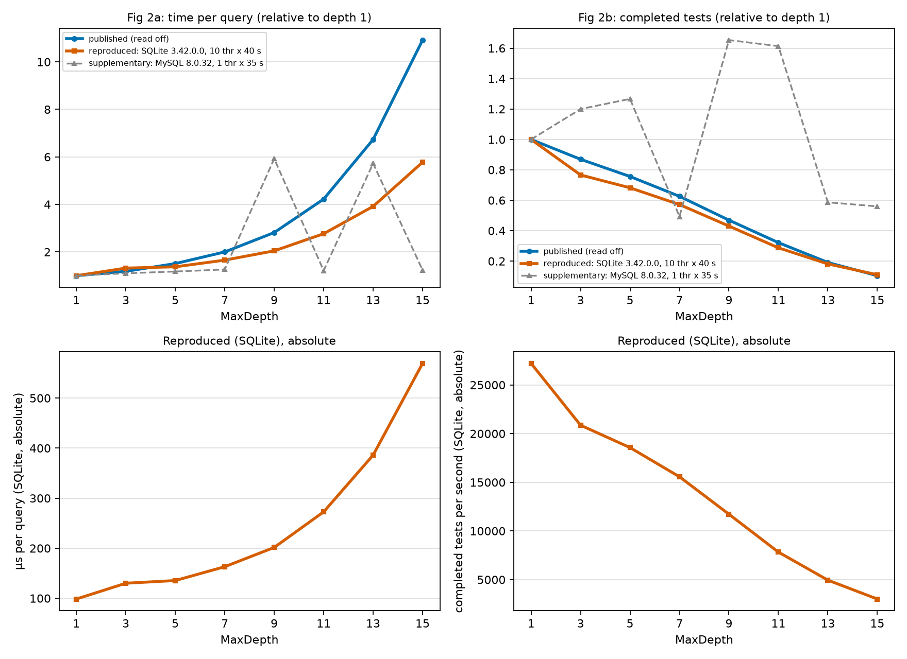

# CODDTest Fig 2 (MaxDepth sweep): reproduction

**Primary result (declared config): SQLite 3.42.0.0, 10 threads, 40 s per depth.** From depth 1 to 15, completed tests fall **-88.9%** (published: -89.4%) and time per query rises **x5.78** (published: x9.91; read-off curve about x10.9). Both curves have the published shape: monotonic decline in tests and monotonic rise in time per query. The time-per-query rise is weaker than published (budget, hardware, and measurement differences below). A 40 s budget gives a trend check, not the paper's 24 h absolute numbers.



| depth | 1 | 3 | 5 | 7 | 9 | 11 | 13 | 15 |
|---|---|---|---|---|---|---|---|---|
| SQLite us/query | 98.6 | 130.1 | 135.5 | 163.1 | 201.6 | 272.7 | 386.1 | 569.4 |
| SQLite completed tests (40 s, 10 thr) | 1,088,539 | 834,481 | 742,569 | 622,666 | 468,814 | 313,198 | 197,987 | 120,348 |

(Published read-off: 49 to 535 us; tests 1.15 to 0.12 x10^9. Our absolute numbers differ: different hardware, 40 s vs 24 h, and our time per query is wall time of the oracle's own queries including result fetching in Java, summed over 10 threads.)

## Fixes to the upstream clone (SQLite path)
- `SQLite3ToStringVisitor` (CASE-mapping visitor, ~line 623) appended `constant.toString()`, which renders typed debug text such as `(INT) 1` and `(BINARY) x'41d6'`. SQLite rejects that. Patched to `visit(constant)`. After the patch the same oracle completed 214,462 tests in 10 s instead of 0.
- `pom.xml`: sqlite-jdbc `3.47.2.0` to `3.42.0.0`; `failOnWarning` to false (ecj warnings abort the build).
- Counters (attempts, completed, queries, query nanos) added to `SQLite3CODDTestOracle` and `MySQLCODDTestOracle`. SQLite "completed" counts `check()` calls that return normally and do not count calls that end in a mismatch AssertionError (SQLite mismatch counters are not instrumented). All patches are in `metrics.patch`.

## Commands (SQLite, primary)
```
docker run --rm -v $PWD:/w -v /tmp/claude-1000/ext/m2:/root/.m2 -w /w maven:3.9.11-eclipse-temurin-17 \
  mvn -q -DskipTests -Dcheckstyle.skip -Dpmd.skip -Dspotbugs.skip package   # in clone with metrics.patch applied
./run_sweep_sqlite.sh /tmp/claude-1000/ext/coddtest/target 40 raw           # ~6 min -> raw/metrics_sqlite.txt
/usr/bin/python3.14 plot.py                                                 # fig2_reproduction.png, raw/summary.json
```
Clone: `github.com/DerZc/sqlancer` commit `3045badb83098ace249a6d5cc2f1cd3bed37b888` (sqlancer PR #1054), in `/tmp/claude-1000/ext/coddtest` (not committed). Oracle: `sqlite3 --oracle CODDTest --coddtest-model expression`, `--num-threads 10 --random-seed 1 --num-tries 1000000`. One run per depth, one seed.

## Deviations
- Budget 40 s per depth vs 24 h; one run per depth, no repeats, so run-to-run variance is unmeasured.
- The paper used sqlite-jdbc for SQLite 3.42.0.0 and the same release of SQLancer; the PR snapshot above may differ from the paper's code.
- Fig 3 (unique query plans) was not attempted.

# Supplementary: MySQL 8.0.32 sweep (earlier fallback, not the declared config)
1 thread, 35 s per depth, via `run_sweep.sh` and `raw/metrics.txt`. Noisy and not a reproduction of the published trend (plotted as the grey dashed series). Details below are from that earlier pass.

### What ran
- Tool: CODDTest SQLancer fork `github.com/DerZc/sqlancer` (the code behind sqlancer PR #1054), commit `3045badb83098ace249a6d5cc2f1cd3bed37b888`, cloned to `/tmp/claude-1000/ext/coddtest` (not committed).
- Target: MySQL 8.0.32 container `csi5137-atdm-mysql8032` (127.0.0.1:3307, root/root). The paper's Fig 2 used SQLite 3.42.0.0, 10 threads, 24 h per depth.
- Oracle: `mysql --oracle CODDTest --coddtest-model expression` (expression-only, no subqueries, as in the paper's "CODDTest & Expression").
- Budget: 1 thread, 35 s per MaxDepth in {1,3,...,15}, `--random-seed 1`, `--num-tries 1000000`.
- Instrumentation (`metrics.patch`, applied to the clone): counts `check()` calls (attempts), `check()` calls that reach the result comparison (completed, including mismatches), SQL queries run by the oracle, and their wall time. "Time per query" = oracle query nanos / oracle queries. The upstream tool does not report these. Its own "Executed N queries" counter stays 0 for this oracle.
- Build: `mvn -DskipTests package` in `maven:3.9.11-eclipse-temurin-17`. I set `<failOnWarning>false</failOnWarning>` in the clone's `pom.xml` because ecj warnings abort the build. Run in `eclipse-temurin:17-jre`.

### Commands
```
# build (in the clone, after `git apply metrics.patch` and the pom change)
docker run --rm -v $PWD:/w -v /tmp/claude-1000/ext/m2:/root/.m2 -w /w maven:3.9.11-eclipse-temurin-17 \
  mvn -q -DskipTests -Dcheckstyle.skip -Dpmd.skip -Dspotbugs.skip package
./run_sweep.sh /tmp/claude-1000/ext/coddtest/target 35 raw     # ~7 min, writes raw/metrics.txt
/usr/bin/python3.14 plot.py                                   # writes fig2_reproduction.png, raw/summary.json
```

### Results (raw/metrics.txt, raw/summary.json)
| depth | 1 | 3 | 5 | 7 | 9 | 11 | 13 | 15 |
|---|---|---|---|---|---|---|---|---|
| us/query | 111 | 122 | 130 | 140 | 655 | 134 | 633 | 137 |
| completed tests | 75 | 90 | 95 | 37 | 124 | 121 | 44 | 42 |

Published (text): time per query x9.91, completed tests -89.4% from depth 1 to 15 (read-off curve: 49 to 535 us, about x10.9).
Ours: time x1.24, tests -44% (depth 15 vs 1).

### Caveats
- DBMS differs (MySQL 8.0.32 vs SQLite 3.42), and 35 s x 1 thread vs 24 h x 10 threads. Absolute numbers are not comparable (ours are in us per query over a network socket to a container).
- Most `check()` calls are ignored by the tool (generator or expected errors), so only 37 to 124 tests complete per run. The sample is small and noisy.
- Depth 9 and 13 show about 5x slower queries and very few attempts (1,487 and 530). That is consistent with a few slow queries or a stall, but I did not investigate it. I did not rerun them.
- The oracle reported 2 to 9 result mismatches per run on MySQL 8.0.32 (`mismatches=` in metrics.txt). I did not triage them. They may be real bugs or false positives of this PR-state code.
- The trend with depth is not reliably shown here. A longer budget and multiple seeds per depth are needed. The paper's trend (monotonic decline) is not contradicted, but also not confirmed.
- Fig 3 (unique query plans) was not attempted.

## Earlier failed SQLite attempt (now resolved)
Before the CASE-visitor fix, SQLite on sqlite-jdbc 3.47.2.0 completed 0 tests in 20 s because about 39% of queries failed with `near "1": syntax error` (`(INT) 1` text). Cause and fix are above.
