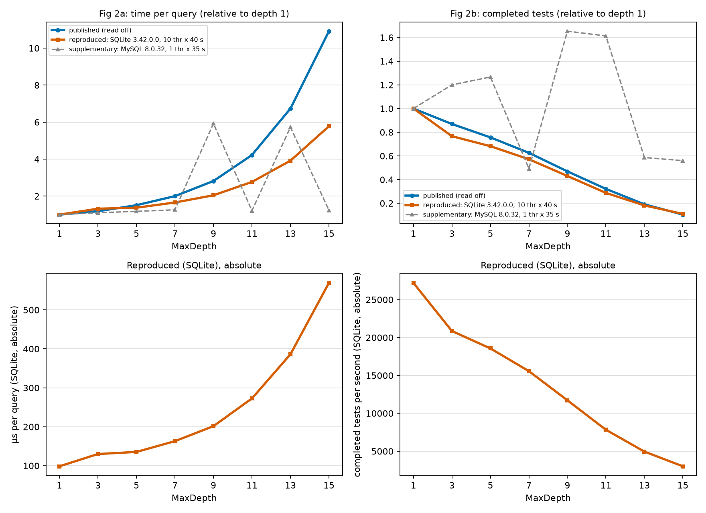

# Project 2 Report — Reproducing Logic Bugs from Four Database-Testing Papers

CSI 5137 A00 — Advanced Topics in Databases and Data Management
Group 12: Fernando Berti Cruz Nogueira, Saatvik Paul, Haekwon Ahn

Repository: this folder's [artifacts/](artifacts/) hold the code, test cases and captured results. Public repository: <https://github.com/seofernando25/csi5137-atdm-db-project> (made public on 2026-11-16).

## 1 Scope and honest summary

Project 2 asks for one paper from Project 1 and at least one reproduced graph. Our declaration fixes the target: **CODDTest, Figure 2** (execution time per query and number of completed tests against `MaxDepth`). §2 reports that reproduction. Separately, as supplementary evidence about all four papers, we replayed **one minimized, already-reported bug** and asserted the bug-specific mismatch on **MySQL 8.0.32** (Docker image `mysql:8.0.32`, linux/amd64).

| Paper | MySQL bug | Mismatch asserted by the runner | Outcome |
|---|---|---|---|
| CODDTest | #111241 | constant-substituted query returns a row; scalar-subquery query is empty | reproduced |
| DDLCheck | #114904 | evolved schema fails an insert that an equivalent direct schema accepts | reproduced |
| WriteCheck | #104833 | final state `[10, 1, 10, 20, 10, 20]` vs oracle `[10, 20, 10, 20, 10, 20]` | reproduced with **Troc**, not WriteCheck's own tool |
| Radar | #110125 | indexed copy returns 1 row, raw copy returns 0 | reproduced |

**Extent of success: partial for the graph, full for the bug cases.** The Figure 2 sweep reproduces the published *shape* with a heavily reduced budget (40 s per depth instead of 24 h, three seeds). The four bug-triggering cases reproduced in the captured runs (one captured run per case in `artifacts/results/`; we did not measure run-to-run stability). We did not rerun any paper's full fuzzing campaign, and we did not attempt Figure 3. The Project 1 figures are re-plots of values read off the published figures; they are not reproductions. See §7.

## 2 Graph reproduction: CODDTest Figure 2

**Target.** Figure 2 of Zhang and Rigger (2025): expression-only CODDTest, no subqueries, `MaxDepth` from 1 to 15, average query execution time and completed tests. The paper ran SQLite 3.42.0.0 with 10 threads for 24 hours per depth. It reports that time per query rises 9.91 times and completed tests fall 89.4% from depth 1 to 15.

**What we ran.** The CODDTest SQLancer fork behind [sqlancer PR 1054](https://github.com/sqlancer/sqlancer/pull/1054) (commit `3045badb`), SQLite 3.42.0.0, 10 threads, `MaxDepth` in {1, 3, …, 15}, **40 seconds per depth**, three seeds. Commands, patches and raw output are in [graph-reproduction/](graph-reproduction/README.md).

**Does the setup match the paper's?** Yes, except for the budget. The clone defaulted to sqlite-jdbc 3.47.2.0; we pinned 3.42.0.0, and `SELECT sqlite_version()` on the run's classpath returns 3.42.0. The paper's exact SQLancer snapshot is unknown. Two other changes do not alter behaviour in intent: `failOnWarning` set to false so the build passes, and counters for completed tests and query time (the tool does not report them for this oracle). One change is a bug fix: on SQLite the CASE-mapping visitor printed typed debug text such as `(INT) 1`, SQLite rejected it, and 0 tests completed. Calling `visit(constant)` fixed it. All changes are in `metrics.patch`.

**Result.**



| Depth 1 → 15 | Reproduced (mean of 3 seeds; range) | Published |
|---|---|---|
| Completed tests | −88.6% (−88.3 to −88.9) | −89.4% |
| Time per query | ×5.58 (×5.48 to ×5.78) | ×9.91 (read-off curve about ×10.9) |

Both curves have the published shape. The decline in tests is within about one point of the paper. The rise in time per query is about 55% of the published factor. Likely causes, none tested: hardware, the 40 s budget, and our measure (wall time of the oracle's own queries, including result fetching, summed over threads). Absolute numbers are not comparable with the paper's 24-hour counts.

**Scaling laws.** We fit five forms (linear, power, exponential, exponential plus constant, quadratic) to each curve relative to depth 1, and ran PySR on the same eight points (`fits.md`, `pysr_log.txt`, `fig_scaling.png`).

| Curve | Best form | Ours | Published |
|---|---|---|---|
| Time per query | constant + exponential, rate per depth level | 0.241 (PySR 0.247) | 0.263 (PySR 0.268) |
| Completed tests | near-linear, slope per depth level | −0.058 (PySR −0.064) | −0.062 (PySR −0.066) |

The growth rates agree within 10%; ours has a smaller exponential part, which is the missing factor in the rise. For the test count the data cannot separate linear, quadratic and exponential-plus-constant (within about 6 AIC). With eight points per curve, and published values read off a figure, this supports the *shape* of the dependence and is not a measured scaling law.

**Verdict.** Partial reproduction. The qualitative claim holds in our run (deeper expressions cost more time per query and complete fewer tests under a fixed budget), and the test decline matches in magnitude. The time-per-query magnitude does not. We did not attempt Figure 3 or count oracle mismatches on SQLite.

## 3 Common method

All four papers share one idea: two executions with the same expected semantics must agree, and a mismatch is a bug oracle.

```text
different execution + same expected semantics
                 ↓
           compare results
                 ↓
       mismatch = bug oracle
```

Each runner (`artifacts/repro/*.sh`) creates fresh databases, runs both executions, prints the observations, and prints `PASS` only if the exact bug-specific mismatch holds. `artifacts/scripts/run_all.sh` runs all four and must end with:

```text
PASS: 4/4 representative MySQL bugs reproduced on MySQL 8.0.32.
```

Build completion alone is not accepted as success.

## 4 The four bug-case reproductions

Observed values below are copied from `artifacts/results/`.

### 4.1 CODDTest — MySQL #111241

*Paper idea.* Evaluate an expression with an auxiliary query, substitute the value (constant folding/propagation), and compare the original and substituted queries.

*Test case.* `t0(c0 BOOL)` holds one row, `true`. The scalar subquery `SELECT MIN(t0.c0) FROM t0` folds to `1`. The two queries differ only in `t0.c0 IN (SELECT MIN(t0.c0) FROM t0)` versus `t0.c0 IN (1)`, inside a larger predicate with `NOT REGEXP`, `NOT LIKE` and a `CASE`.

*Observed.*

```text
folded_value=1
constant_form=1
subquery_form=<empty>
PASS: MySQL #111241 reproduced.
```

*Reading.* The value is 1 in both forms, so the queries are equivalent. MySQL returns a row for one and none for the other. The mismatch is the bug.

### 4.2 DDLCheck — MySQL #114904

*Paper idea.* Build the same final schema through different DDL histories and compare later behavior.

*Test case (evolved).* Create `t0`, create `t1` with a foreign key to `t0`, then `ALTER TABLE t0 RENAME AS t2, ALGORITHM COPY`. *Direct:* create `t2` and `t1` referencing `t2`.

*Observed.* The evolved `SHOW CREATE TABLE t1` shows `REFERENCES t2 (c2)`. A valid `INSERT INTO t1 (c1) VALUES (1)` still fails with `ERROR 1452 ... REFERENCES t0 (c2)`, naming the stale table. The direct schema accepts the insert (`direct_schema_inserted_value=1`).

*Reading.* The visible schema and the enforced constraint disagree after the rename. Query-only testing would not reach this state.

### 4.3 WriteCheck — MySQL #104833 (Troc replay)

*Paper idea.* Run restricted concurrent write transactions and compare the final state with a serial/oracle execution.

*Important limit.* The MySQL tracker entry for #104833 is restricted. We replay Troc's public testcase `cases/mysql104833.txt` with the Troc artifact pinned at commit `a6d50e3f596b356137d2f8c3c8b31a61bf7fe2c5`, using Troc's MVCC oracle. This is **not** an execution of WriteCheck's own WSS method.

*Test case* (`artifacts/repro/writecheck_104833.case.txt`): `t(a, b)` with rows `(NULL,1),(2,2),(NULL,3)`. Two READ COMMITTED transactions run `UPDATE t SET a = 10` and `UPDATE t SET b = 20 WHERE a` under schedule `1-1-2-2-1-2`.

*Observed.*

```text
FinalState (MySQL):  [10, 1, 10, 20, 10, 20]
FinalState (oracle): [10, 20, 10, 20, 10, 20]
Error: Inconsistent final database state
```

*Reading.* The second transaction's blocked update should apply to the first row once `a` becomes 10. MySQL leaves `b = 1` there.

### 4.4 Radar — MySQL #110125

*Paper idea.* Keep the data, drop the metadata, and compare one query on both databases.

*Test case.* Two databases hold `t0(c0 DOUBLE ZEROFILL)` with one row `0`. Only the indexed copy has `CREATE INDEX i0 ON t0 (c0 DESC)`. Query: `SELECT COUNT(*) FROM t0 WHERE (IFNULL(-1123870957, '')) IN (t0.c0);`

*Observed.*

```text
indexed_rows=1
raw_rows=0
PASS: MySQL #110125 reproduced.
```

*Reading.* The raw copy's empty result is correct; the indexed copy's single row is the bug. `DOUBLE ZEROFILL` is deprecated since 8.0.17, and the repository notes that all 8.0.x releases are affected.

## 5 Reproduction journey

This section uses only evidence in the repository (`git log`, captured results). Anything not recorded in the repository is marked as such.

1. **First three cases (commit `0131342`).** CODDTest #111241, DDLCheck #114904 and WriteCheck #104833 were reproduced together, with the Troc pin and runner already present.
2. **A failed attempt: CODDTest #111421.** `results/coddtest_111421.txt` shows the case does **not** reproduce. The script ran `CREATE TABLE` with `CHECK(true)` and MySQL 8.0.32 returned `ERROR 3813: Column check constraint 't0_chk_1' references other column` (exit 1). The root README in the first commit (`0131342`) claimed #111421 "also reproduces on 8.0.32". The captured output contradicts that claim: its script has no PASS/FAIL oracle, and its own expectation line ("CREATE TABLE with CHECK(true) is rejected") describes a rejection that is the observed output, not evidence of the reported bug. We therefore do not count it as a reproduction, and it is excluded from the 4/4 suite. We did not diagnose the cause. *Inference:* the case may depend on a different server version or statement form.
3. **Presentation and notes** were built on the three cases (commits `f58d555` onward).
4. **Public source for #104833 (commit `5faf652`).** Because the MySQL tracker entry is restricted, the README and `papers/README.md` were changed to cite Troc's public testcase and to state that the replay is Troc-based.
5. **Radar added (commit `2f6659e`).** A fourth runner and result were added for #110125, and `run_all.sh` now ends with the 4/4 line.
6. **Author or upstream communication:** none. No emails, issues or comments to the paper authors or MySQL are recorded in the repository, and none were sent for this report.
7. **Re-run for this report (2026-11-16).** `./scripts/setup.sh` rebuilt the pinned Troc and `./scripts/run_all.sh` ran all four runners. It ended with `PASS: 4/4 representative MySQL bugs reproduced on MySQL 8.0.32.` (exit 0). The WriteCheck run again printed `Error: Inconsistent final database state` with final states `[10, 1, 10, 20, 10, 20]` (MySQL) and `[10, 20, 10, 20, 10, 20]` (oracle).

## 6 Lessons about the papers and about reporting

- **Minimized cases carry the lesson; papers rarely do.** Each bug needed only a few SQL statements, but the papers describe the *method*. We located the concrete cases through bug trackers and artifacts, not the papers.
- **Restricted trackers weaken reproducibility.** #104833 was reachable only through Troc's public copy. The oracle in Troc is related to, but not the same as, WriteCheck's.
- **The oracle needs the right equivalence.** In the CODDTest case, an incorrect substitution would be a bad test, not a bug. The runner therefore requires the folded value to be 1, the constant form to return 1, and the subquery form to be empty, all in one final condition.
- **Version pinning matters.** #111421 failed on the pinned 8.0.32 image. Papers should state the exact version a bug was observed on.
- **One case is not the campaign.** These cases show that each oracle can detect a known bug. They say nothing about detection rates or about MySQL relative to other DBMSs, and we make no such claim.

## 7 Limitations and open gap

- Figure 2 was reproduced with 40 s per depth and three seeds; seed spread is small, but a 24-hour run was not attempted. Figure 3 (unique query plans) was not attempted.
- The SQLite fix and counters change the upstream tool; the PR snapshot may differ from the code the paper used.
- WriteCheck is replayed with Troc, not WriteCheck's own tool.
- Results come from one pinned image (`mysql:8.0.32`); we did not vary versions or platforms.
- The captured outputs in `artifacts/results/` come from earlier runs; the 2026-11-16 re-run (§5, item 7) matched them. The copied `artifacts/` layout has not been run from that location; run from the repository root.
- #111421 remains unreproduced and its cause is unexplained. The captured output is `ERROR 3813` on MySQL 8.0.32; we did not test other versions.

## 8 Reproducing this work

From the repository root:

```bash
./scripts/setup.sh      # starts the mysql:8.0.32 container, builds pinned Troc
./scripts/run_all.sh    # must end with: PASS: 4/4 representative MySQL bugs reproduced on MySQL 8.0.32.
```

Requirements: Docker, Git. The container is `csi5137-atdm-mysql8032` on host port 3307 (`root`/`root`). See `artifacts/README.md` for the copied layout.

## 9 Acknowledgment of LLM use

Claude Code (Anthropic) assisted with this project. It wrote and revised the shell runners; patched the upstream CODDTest/SQLancer clone (the SQLite CASE-visitor fix, the sqlite-jdbc pin, and the counters in `metrics.patch`); ran the Figure 2 sweeps and wrote the plotting, curve-fitting and PySR scripts; summarized the papers; and drafted this report from repository evidence. The authors chose the target figure, set the experimental plan, and are responsible for the claims. Observed values were checked against `artifacts/results/` and `graph-reproduction/raw/`. A Haiku-model reviewer checked the numbers in this report against those files; not every author has proofread the text.
